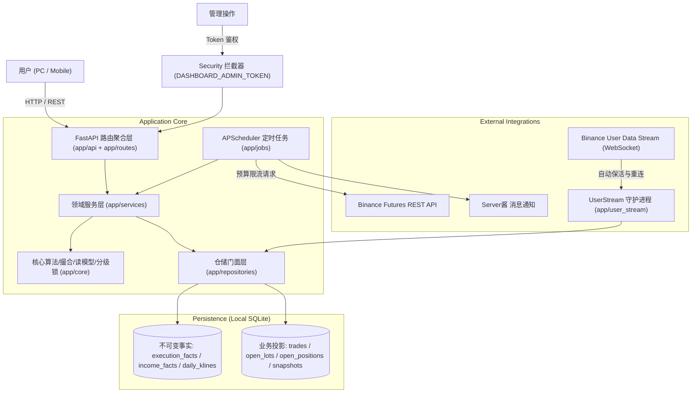

# 🚀 ZS's Crypto Shorting Cockpit (加密货币空头驾驶舱)


> **"Slow is Smooth, Smooth is Fast." (慢就是快)**
>
> 这是一个专为加密货币（币安 USDT-M 合约）量化交易者打造的、**移动端优先**的专业级交易分析、实时监控与智能风控决策系统。系统基于“第一性原理 (Facts vs Projections)”构建，集成了机构级风控协议、确定性历史账本、实时战场监控与每日市场信号快照。

---

## 📚 项目技术文档中心

项目提供了完备的工程设计与规格文档，详细内容请参阅 [文档中心](docs/README.md)：
- 🏛️ [系统架构设计](docs/architecture/system-architecture.md)：模块化单体分层、领域服务编排、第一性原理账本与分级隔离锁。
- 🌊 [全景数据流设计](docs/architecture/data-flow.md)：端到端数据采集、状态化批次撮合、07:00 晨间五榜与风控闭环时序。
- 📖 [数据字典](docs/reference/data-dictionary.md)：全库持久化表结构、字段含义、主键约束与索引规划。
- 🔌 [REST API 参考](docs/reference/api-reference.md)：业务领域 REST API 端点、参数与权限说明。
- 📜 [系统审计与演进资料](docs/README.md)：第一性原理重构、暴跌风险雷达设计与历史审计验证报告。

---

## ✨ 核心功能特性

### 📊 1. 深度交易分析 (Analytics Dashboard)
超越交易所自带的基础报表，提供核心量化指标：
- **机构级绩效评估**: 自动计算 **夏普比率 (Sharpe)**、**卡玛比率 (Calmar)**、**索提诺比率 (Sortino)** 和 **系统质量数 (SQN)**。
- **资金管理辅助**: 内置 **凯利公式 (Kelly Criterion)** 建议，基于历史胜赔率动态推荐最佳仓位比例。
- **可视化报表**:
  - **权益曲线**: 精确的累计净值走势（自动剔除充提币出入金影响，支持百万点等步长下采样秒开）。
  - **持仓时长与盈亏分布**: 散点图分析持仓时间与盈亏的关系（Duration Analysis）。
  - **时段分析**: 24小时盈亏热力图，识别最佳交易时段。
  - **红黑榜**: 自动统计各币种的胜率、盈亏贡献度与交易频次。
  - **月度目标追踪**: 实时对比月度收益目标与达成进度条。

### 📱 2. 实时战场监控 (Live Monitor)
专为多屏协同和移动办公设计的实时监控台：
- **秒级同步**: 并行数据加载架构，确保价格、持仓和账户余额毫秒级刷新。
- **移动端适配**: 独创的 **"Card View" (卡片视图)**，在手机端自动将宽表格转换为卡片，关键信息（uPnL, ROI, 持仓时长）一目了然。
- **全景风险视图**: 实时计算 **真实杠杆率 (Real Leverage)**、**净风险敞口 (Net Exposure)** 和 **持仓集中度 (HHI / Top3)**。
- **自选与备注 (Watch Notes)**: 支持一键标记自选观察标的，并持久化保存。

### 🛡️ 3. 智能风控与复盘协议 (Risk Protocols)
系统内置自动化风控规则，时刻监控账户健康：
- **回撤熔断**: 实时监控当前回撤 (Drawdown)，配合账户健康度评分系统 (Health Score)。
- **僵尸仓位预警**: 自动标记持仓超过 **48小时** 的短线订单 (Stale Position)。
- **过夜风险提示**: 监控每日 23:00 后的持仓符号数量，防止过度分散（默认不超过 5 个）。
- **连败保护**: 监控近期连续亏损笔数，触发“熔断”建议。
- **午间浮亏快照**: 每天 **11:50 (UTC+8)** 自动记录“若全部止损”的预计亏损、占余额比例及逐币种快照。
- **夜间止损复盘**: 每天 **23:02 (UTC+8)** 自动复盘午间建议标的，量化统计“若不砍仓抗单”到夜间的实际亏损与基线差值，支持近 14 天逐币种明细对比下钻。

### ⚡ 4. 暴跌/插针风险雷达 (Crash Risk Radar)
基于涨幅榜衍生计算的多因子崩盘风险感知模块：
- **三级风险阶段**: 自动判定标的处于 `HIGH_RISK` (高危)、`WARNING` (预警) 还是 `WATCH` (观察)。
- **多维度评分**: 综合评估极端涨幅偏离、持仓量 (OI) 异动衰减、多周期技术面过热等多维驱动因子。

### 🏆 5. 每日涨幅榜快照与复盘 (Market Leaderboard & Rebound)
- **共享日线缓存**: **06:15 (UTC+8)** 增量回填 `daily_klines`，首次补齐 365 根，后续每日仅拉最新 1~2 根完结日线。
- **一次生成五榜**: **07:00 (UTC+8)** 仅请求一次全市场 Ticker，纯本地零网络开销生成：
  1. 24H 涨跌幅榜 (`leaderboard`)
  2. 14D 反弹榜 (`rebound-7d`)
  3. 30D 反弹榜 (`rebound-30d`)
  4. 60D 反弹榜 (`rebound-60d`)
  5. 365D 年化反弹榜 (`rebound-365d`)
- **快照极速通知**: **07:30 (UTC+8)** 直接读取已保存快照推送微信/Server酱通知，不触发外部网络请求。
- **持仓联动与回看**: 支持历史任意日期快照回溯，并自动标记“已持仓”标的。

### 💎 6. 第一性原理数据底座与极致性能
- **不可变事实账本**: 逐笔成交 (`execution_facts`) 与资金流水 (`income_facts`) 作为底层事实持久化，计算与采集解耦，支持任意时点无损重放。
- **状态化批次撮合**: 持久化开仓在途批次 (`open_lots`)，采用 FIFO 撮合引擎，彻底解决跨窗口上下文丢失与双向持仓覆盖。
- **骨架屏与长缓存**: 静态资源长缓存 + 骨架屏加载，拒绝白屏跳动；纯原生无框架依赖，秒级极速响应。

---

## 🛠️ 系统架构

本项目采用**模块化单体 (Modular Monolith)** 分层设计：



---

## 🚀 快速开始

### 环境要求
- Python 3.10+
- 能够访问币安 API 的网络环境 (建议使用香港/日本节点)

### 1. 安装
```bash
# 克隆仓库
git clone <repository_url>
cd crypto_dashboard

# 创建虚拟环境
python3 -m venv .venv
source .venv/bin/activate  # Windows: .venv\Scripts\activate

# 安装依赖
pip install -r requirements.txt
```

### 2. 配置
复制环境变量并填入您的 API Key：
```bash
touch .env
```

在 `.env` 文件中配置关键项（完整环境变量参考下文）：
```ini
# 币安 API 凭证 (只读权限即可)
BINANCE_API_KEY=your_api_key_here
BINANCE_API_SECRET=your_api_secret_here

# 管理写操作接口安全令牌 (生产环境必须配置随机高强度Token)
DASHBOARD_ADMIN_TOKEN=your_secure_random_token_here

# Server酱通知 (可选)
SERVERCHAN_SENDKEY=your_serverchan_key_here
```

### 3. 运行
```bash
# 启动开发服务器
uvicorn app.main:app --reload --host 0.0.0.0 --port 8000
```
访问 `http://localhost:8000` 即可使用仪表盘。

生产部署建议：
- 推荐单实例运行内置 scheduler：`UVICORN_WORKERS=1`。
- 多 Worker 部署时应用会自动禁用内置 scheduler 防重复触发，需指定单进程执行任务。

---

## 🖥️ 页面与 API 汇总

### 1. 前端页面视图
- `/`：交易分析主面板（TRADES - 胜率、权益曲线、盈亏散点图、时段热力图、月度目标）
- `/live-monitor`：实时战场监控（MONITOR - 实时持仓卡片、杠杆敞口、午间浮亏快照、夜间止损对比复盘）
- `/leaderboard`：每日榜单快照与复盘（LEADERBOARD - 24H涨跌幅榜、14D/30D/60D/365D 反弹榜）
- `/crash-risk`：暴跌/插针风险雷达（RADAR - 高危标的崩盘风险评分与预警）
- `/metrics`：量化指标与风控协议说明（METRICS）
- `/logs`：系统运行与同步审计日志（LOGS）

### 2. 核心 REST API 路由
- **交易与分析**：
  - `GET /api/summary`：交易全局汇总指标与净值曲线
  - `GET /api/trades?limit=10&offset=0`：已平仓交易分页明细
  - `GET /api/daily-stats`：按日统计的战绩汇总
  - `GET /api/trades-aggregates?window=all|7d|30d`：持仓时长与盈亏聚合数据
  - `GET /api/monthly-progress`：月度盈利目标进度
  - `POST /api/monthly-target` 🔒：更新月度盈利目标
- **实时持仓与风控**：
  - `GET /api/open-positions`：当前持仓全景与午夜风控快照（支持版本感知增量）
  - `POST /api/positions/set-long-term` 🔒：设置标的长期持有状态
  - `GET /api/balance-history?time_range=1d`：账户保证金余额历史曲线（支持 1h/1d/1w/1m/1y 下采样）
  - `GET /api/noon-loss-review-history?limit=14`：近 N 天午间建议 vs 夜间实际对比复盘明细
- **市场快照与反弹榜**：
  - `GET /api/leaderboard?date=YYYY-MM-DD`：读取指定日期 24H 涨幅榜快照
  - `GET /api/leaderboard/dates`：可选涨幅榜快照日期列表
  - `GET /api/leaderboard/metrics-history`：涨幅榜次日动量指标历史
  - `GET /api/rebound-{7d|30d|60d|365d}?date=YYYY-MM-DD`：各周期反弹榜快照
  - `GET /api/rebound-{7d|30d|60d|365d}/dates`：各周期反弹榜历史日期列表
- **暴跌风险雷达**：
  - `GET /api/crash-risk`：读取最新暴跌风险雷达评分与阶段
  - `POST /api/crash-risk/refresh`：重新触发暴跌风险评分计算
- **观察自选备忘**：
  - `GET /api/watch-notes`：获取自选关注标的列表
  - `POST /api/watch-notes` 🔒：添加自选关注标的
  - `DELETE /api/watch-notes/{note_id}` 🔒：移除自选关注标的
- **系统与运行状态**：
  - `GET /api/status`：系统健康度、调度器与 WebSocket 连通性
  - `GET /api/logs`：实时系统运行日志
  - `GET /api/sync-runs`：同步作业流水审计日志
  - `POST /api/sync/manual` 🔒：手动触发数据同步作业

*注：标注 🔒 的写操作接口需在请求头携带 `X-Admin-Token`。*

---

## ⚙️ 关键配置参数说明 (`.env`)

| 配置项 | 默认值 | 说明 |
| :--- | :--- | :--- |
| `BINANCE_API_KEY` | - | 币安 API Key（需只读权限） |
| `BINANCE_API_SECRET` | - | 币安 API Secret |
| `DASHBOARD_ADMIN_TOKEN` | - | 管理写接口授权令牌（生产环境必填） |
| `SERVERCHAN_SENDKEY` | - | Server酱微信推送 Key |
| `ENABLE_USER_STREAM` | `0` | 是否启用 WebSocket 用户数据流（带断线自愈守护） |
| `UPDATE_INTERVAL_MINUTES` | `3` | 增量同步轮询基础间隔 |
| `ENABLE_TRIGGERED_TRADES_COMPENSATION` | `1` | 启用未平仓变动触发的闭仓补偿同步 |
| `TRADES_INCREMENTAL_FALLBACK_INTERVAL_MINUTES` | `1440` | 触发补偿模式下的全量兜底任务间隔（分钟） |
| `OPEN_POSITIONS_UPDATE_INTERVAL_MINUTES` | `5` | 持仓 REST 校验周期（分钟） |
| `BALANCE_SYNC_INTERVAL_MINUTES` | `15` | 余额轮询间隔（分钟，支持浮点数如 `0.5` 即30秒） |
| `DAYS_TO_FETCH` | `60` | 默认同步回溯天数（最大不超过 90 天） |
| `DAILY_KLINE_UPDATE_HOUR` / `MINUTE` | `6:15` | 共享日线增量同步时点 (UTC+8) |
| `MARKET_SNAPSHOT_HOUR` / `MINUTE` | `7:00` | 晨间全市场五大榜单生成时点 (UTC+8) |
| `LEADERBOARD_ALERT_HOUR` / `MINUTE` | `7:30` | 榜单微信推送通知时点 (UTC+8) |
| `NOON_LOSS_CHECK_HOUR` / `MINUTE` | `11:50` | 午间浮亏快照执行时点 (UTC+8) |
| `NOON_REVIEW_HOUR` / `MINUTE` | `23:02` | 午间止损夜间复盘对比执行时点 (UTC+8) |
| `HISTORICAL_TASK_WEIGHT_BUDGET_PER_60S` | `200` | 历史任务每 60 秒权重预算上限 |

---

## 🎯 实盘策略 SOP（循环制）

1. **`05:00-08:00` 开单窗口（UTC+8）**
   - 标的池来源：当日涨幅榜 Top10、14D 反弹榜 Top10、昨日涨幅榜强势延续池。
   - 仓位管理：每个标的固定名义仓位（如 `3000U`），`2x` 杠杆，**逐仓做空**。
2. **`11:50-11:55` 午间持仓纪律检查**
   - 浮亏仓位全部砍掉止损。
   - 浮盈或持平仓位继续持有。
3. **`23:00` 过夜仓位检查**
   - 常规情况下，过夜持仓总数严格控制在 **5 个标的** 以内，杜绝过度分散。
4. **次日 `05:00-08:00` 存量仓位轮转**
   - 旧盈利仓位在前序 1H 高点设置保护止盈单。
   - 保护单生效后，上调杠杆倍数以释放保证金，为新开仓腾出资金。
5. **进入下一轮循环**。

---

## 📂 项目工程目录结构

```
crypto_dashboard/
├── app/                              # 应用核心代码
│   ├── main.py                       # FastAPI 启动入口、生命周期与路由装配
│   ├── scheduler.py                  # APScheduler 调度器注册与状态管理
│   ├── user_stream.py                # 币安 WebSocket 用户流（自愈重连守护）
│   ├── binance_client.py             # 币安 REST API 客户端（Session复用与限流）
│   ├── notifier.py                   # Server酱消息推送通知组件
│   ├── models.py                     # 全局 Pydantic 响应与请求模型
│   ├── security.py                   # 管理写接口 Admin Token 鉴权依赖
│   ├── static_assets.py              # 静态资源版本号生成工具
│   ├── api/                          # REST API 领域路由层
│   │   ├── balance_api.py            # 余额历史与资金曲线
│   │   ├── crash_risk_api.py         # 暴跌/插针风险雷达
│   │   ├── leaderboard_api.py        # 涨跌幅榜快照与指标历史
│   │   ├── positions_api.py          # 实时持仓与风控快照
│   │   ├── rebound_api.py            # 14D/30D/60D/365D 反弹榜快照
│   │   ├── system_api.py             # 系统日志、复盘历史与同步流水
│   │   ├── trades_api.py             # 交易明细、全局指标与目标设置
│   │   └── watchnotes_api.py         # 自选观察标的备忘录
│   ├── routes/                       # 前端 HTML 页面渲染路由
│   │   ├── trades.py                 # 交易分析主页 (/)
│   │   ├── leaderboard.py            # 涨幅榜页面 (/leaderboard)
│   │   ├── crash_risk.py             # 暴跌雷达页面 (/crash-risk)
│   │   └── system.py                 # 健康状态与日志 (/logs, /metrics)
│   ├── services/                     # 业务领域服务层
│   │   ├── positions_service.py      # 持仓计算与读模型编排
│   │   ├── balance_service.py        # 余额下采样与资金时序
│   │   ├── market_snapshot_service.py# 晨间五榜快照原子生成
│   │   ├── crash_risk_service.py     # 暴跌风险综合评分引擎
│   │   ├── trade_etl_service.py      # 交易增量同步与批次撮合
│   │   └── leaderboard_service.py    # 榜单历史查询与动量计算
│   ├── repositories/                 # 数据持久化仓储门面层 (SQL 操作)
│   │   ├── sync_write_repository.py  # 事实与批次撮合写入
│   │   ├── trade_read_repository.py  # 交易战绩与聚合查询
│   │   ├── daily_kline_repository.py # 日 K 线本地缓存管理
│   │   ├── snapshot_repository.py    # 各类快照持久化
│   │   └── crash_risk_repository.py  # 暴跌雷达快照存储
│   ├── jobs/                         # APScheduler 后台调度任务实现
│   │   ├── market_snapshot_jobs.py   # 日线回填与五榜生成任务
│   │   ├── noon_loss_job.py          # 午间浮亏与夜间复盘任务
│   │   ├── balance_sync_job.py       # 余额与出入金同步任务
│   │   └── alert_jobs.py             # 晨间榜单与风控告警通知任务
│   └── core/                         # 核心算法与底层基础设施
│       ├── trade_matching.py         # FIFO 状态化批次撮合引擎
│       ├── read_model.py             # 版本感知与写失效读模型缓存
│       ├── job_runtime.py            # 分级任务并发隔离锁 (Tiered Lock)
│       ├── binance_request_budget.py # 交易所请求权重预算限流器
│       ├── time.py                   # 统一时间解析与 UTC/UTC+8 转换
│       └── db_migrations/            # 数据库版本化迁移脚本
├── templates/                        # Jinja2 前端页面模板
│   ├── index.html                    # 交易分析仪表盘 (TRADES)
│   ├── live_monitor.html             # 实时战场监控台 (MONITOR)
│   ├── leaderboard.html              # 每日涨幅榜快照 (LEADERBOARD)
│   ├── crash_risk.html               # 暴跌/插针风险雷达 (RADAR)
│   ├── metrics.html                  # 指标说明与公式文档 (METRICS)
│   └── logs.html                     # 实时日志与审计流水 (LOGS)
├── static/                           # 前端静态资源 (CSS / JS)
├── data/                             # 数据存储目录
│   └── trades.db                     # SQLite 数据库文件 (WAL 模式，27 张表)
├── docs/                             # 系统技术文档库
│   ├── README.md                     # 文档中心与分类约定
│   ├── architecture/                 # 当前系统架构与数据流
│   ├── reference/                    # API 与数据字典
│   ├── plans/                        # 历史演进与重构设计提案
│   └── audits/                       # 系统审计报告与离线探针脚本
├── tests/                            # 自动化测试用例集合 (67 个测试文件)
├── requirements.txt                  # Python 依赖清单
```

---

## ⚠️ 免责声明

本系统仅供**量化研究与个人交易辅助**使用：
- 加密货币衍生品交易具有极高市场风险，可能导致本金全额损失。
- 作者不对因代码缺陷、网络延迟、交易所 API 故障或不可抗力导致的资金损失承担任何法律责任。
- 实盘使用前请务必使用小额资金充分验证所有策略与风控规则。

---

## 📄 License

MIT License
