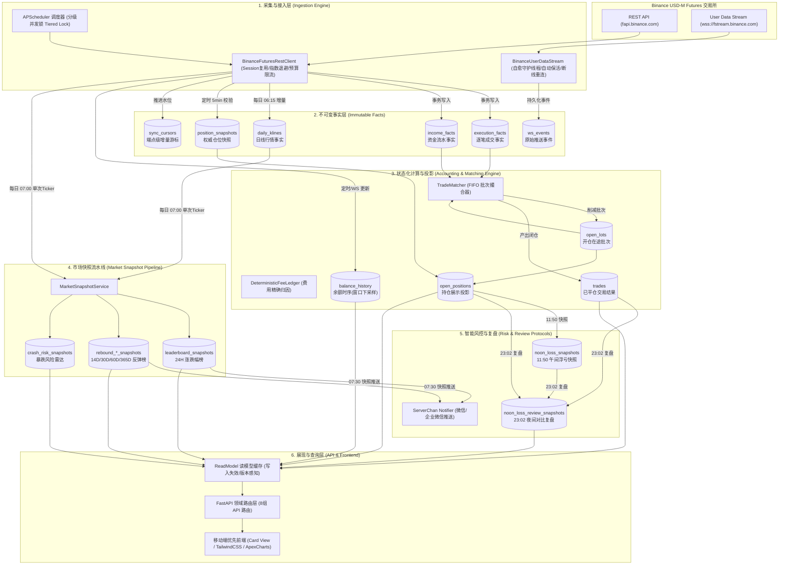

# 全景数据流设计 (Data Flow Architecture)

本文档阐述系统端到端的数据流转、摄取管道、状态化记账投影以及各后台流水线的协同机制。

---

## 一、核心设计哲学：事实与投影分离 (Facts vs Projections)

系统遵循**第一性原理 (First Principles)** 记账模型：
1. **事实先于结果 (Facts First)**：交易所原始数据（逐笔成交、资金流水、日线行情）必须首先作为**不可变事实 (Immutable Facts)** 写入事实表，并安全推进采集游标；计算失败仅需重新重放事实，禁止因计算异常导致数据重拉或状态污染。
2. **状态化批次撮合 (Stateful Lot Matching)**：历史开仓以开仓批次 (`open_lots`) 形式持久化，平仓事件按 FIFO 规则削减开仓批次并闭合为 `trades` 记录，彻底摆脱无状态撮合因拉取窗口过短导致的开仓丢失或双向持仓覆盖。
3. **读写解耦与零阻断查询 (Zero-Blocking Reads)**：所有前端页面与 API 读取操作**100% 仅访问本地 SQLite 数据库或只读模型缓存**，杜绝页面访问反向触发交易所 REST 请求。

---

## 二、端到端数据流全景架构

---

## 三、核心数据管道与执行时序

### 1. 交易增量与闭仓补偿流水线 (`Sync Pipeline`)
- **双模触发机制**：
  - **触发式补偿 (Triggered Compensation)**：当实时持仓监控（WS 或 5 分钟持仓轮询）检测到持仓减少或平仓时，系统立即向内存/调度器注册轻量级补偿任务，仅针对发生变化的交易对以 `SYMBOL_SYNC_OVERLAP_MINUTES` 为缓冲拉取并撮合。
  - **低频兜底任务 (Fallback Incremental)**：默认每 1440 分钟（每天一次）由调度器执行低频全量端点游标兜底，确保万无一失。
- **事务与幂等保障**：
  - 采用 SQLite 事务：逐笔成交写入 `execution_facts`、资金流水写入 `income_facts`、更新 `sync_cursors` 在同一事务内完成。
  - 撮合引擎重放未完全消减的 `open_lots`，产生确定性结果后批量提交 `trades` 并更新 `trade_summary` 聚合指标。

### 2. 市场日线与五大榜单生成流水线 (`Market Pipeline`)
- **06:15 共享日线增量回填 (`refresh_daily_klines`)**：
  - 以滚动 60 秒 200 权重预算上限，全市场增量同步 `daily_klines`。首次运行回填 365 根日 K 线，后续日常仅补齐最新 1~2 根完结日线。
- **07:00 晨间五榜原子生成 (`build_all_market_snapshots`)**：
  - 全流程**仅发起一次** Binance 全市场 24H 行情 Ticker 请求（消耗 40 权重）。
  - 基于同一份 Ticker 与本地 `daily_klines` 日线事实，纯本地无 REST 请求并行生成五大榜单：
    1. 24H 涨跌幅榜 (`leaderboard_snapshots`)
    2. 14D 反弹榜 (`rebound_7d_snapshots`)
    3. 30D 反弹榜 (`rebound_30d_snapshots`)
    4. 60D 反弹榜 (`rebound_60d_snapshots`)
    5. 365D 年化反弹榜 (`rebound_365d_snapshots`)
- **07:05 暴跌/插针风险雷达计算 (`build_crash_risk_snapshot`)**：
  - 以涨幅榜标的为候选池，结合极端涨幅、持仓量异动与周期偏离计算风险评分。
- **07:30 晨间微信通知 (`send_morning_top_gainers`)**：
  - 仅直接读取 07:00 已经落库的数据库快照，将 Top 涨幅与反弹标的推送至微信，**零网络开销、零延迟卡顿**。

### 3. 智能风控与夜间止损复盘流水线 (`Risk Protocols`)
- **11:50 午间浮亏快照 (`check_losses_noon`)**：
  - 抓取当前所有未平仓持仓，计算浮动亏损大于 0 的标的。
  - 模拟记录“若全部止损”所需承担的总亏损额、占当前账户余额比例及逐币种快照明细，写入 `noon_loss_snapshots`。
- **23:00 睡前仓位风控检查 (`risk_check_sleep`)**：
  - 检查当前持仓数量是否超出上限（默认 5 个），若超出则向 ServerChan 告警。
- **23:02 午间止损夜间复盘 (`review_noon_loss_night`)**：
  - 提取当日 11:50 建议砍仓的标的列表。
  - 对比夜间此时的实际平仓或当前浮亏状态，计算“持仓抗单损益 vs 午间砍仓损益”的差值 (`delta_loss_total`)。
  - 存入 `noon_loss_review_snapshots`，并在前端实时监控页展示直观对比图表，量化验证执行纪律。

---

## 四、自愈型连接与容灾机制

### 1. WebSocket User Stream 自愈双模
- 守护线程 `_run_supervisor` 持续监控 WebSocket 连接活性。
- 每 25 分钟向币安发送 `PUT /fapi/v1/listenKey` 维持链路活跃。
- 遇网络波动断线时，采用指数退避重试（2s -> 4s -> 8s -> ... -> 60s），并在无法刷新时自动重新申请 `listenKey`。
- 即使 WebSocket 断线，系统仍保留 30 秒至 5 分钟的低频 REST 轮询作为坚固兜底，保证账目连续性。

### 2. 余额高频监控与下采样防卡死
- 余额监控支持以 30 秒至 1 分钟的高频节奏轮询记录 `balance_history`。
- 针对 1 个月、1 年或全量历史的余额查询，后端通过 SQLite 窗口函数 `ROW_NUMBER() OVER` 实施等步长下采样，强制平滑缩减至均匀分布的 1,000 个数据点，既保证前端 ApexCharts 秒级渲染无卡顿，又精确保留历史首尾真实权益。
